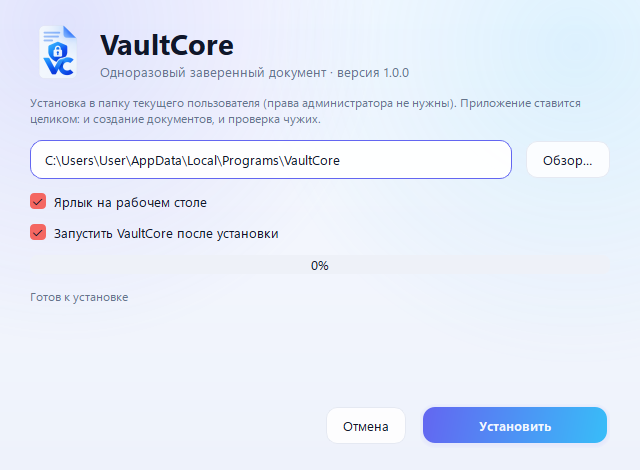
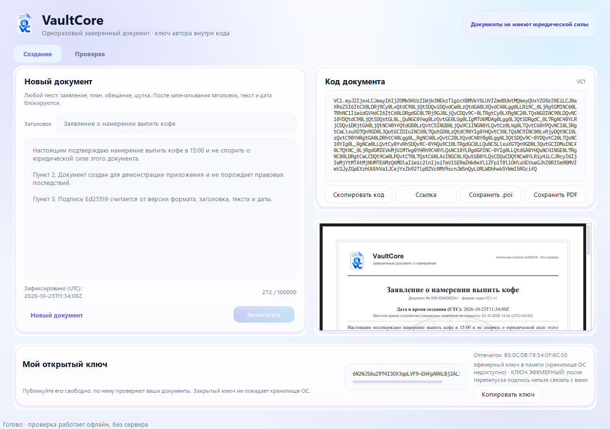
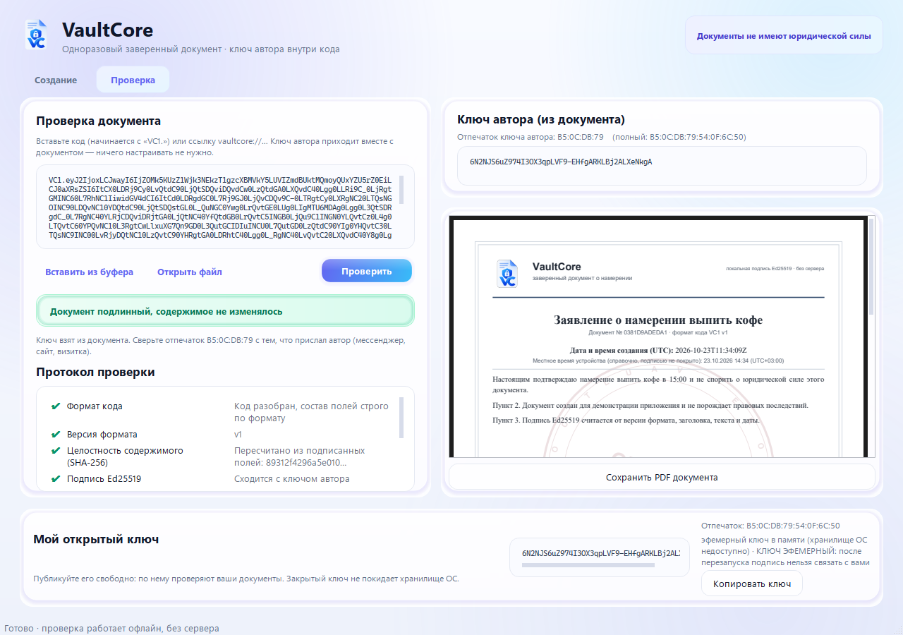
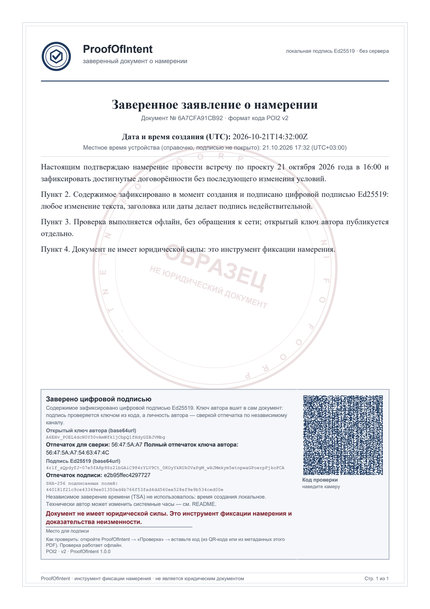

# VaultCore — одноразовый заверенный документ

Настольное приложение: вы пишете текст, «запечатываете» его и передаёте
получателю кодом (или PDF с QR). Получатель открывает документ и убеждается,
что содержимое не менялось, время создания зафиксировано, а подпись сделана
именно владельцем приложения. Сервера нет: всё локально, проверка работает
офлайн.

> **Документы не имеют юридической силы.** Приложение не является юридическим
> сервисом, нотариусом или средством заверения документов. Это инструмент
> фиксации намерения и доказательства неизменности содержимого. Пометка стоит
> на каждом документе, на главном экране, в соглашении и здесь.

| Установщик | Режим «Создание» | Режим «Проверка» | Документ A4 |
|---|---|---|---|
|  |  |  |  |

Готовый пример документа: [`examples/sample_document.pdf`](examples/sample_document.pdf)
(подписан демонстрационным ключом, см. [`examples/README.md`](examples/README.md)).

---

## Содержание

1. [Быстрый старт](#1-быстрый-старт)
2. [Одна программа для всех](#2-одна-программа-для-всех)
3. [Ключи](#3-ключи)
4. [Создание документа](#4-создание-документа)
5. [Передача получателю](#5-передача-получателю)
6. [Проверка](#6-проверка)
7. [Оформление PDF](#7-оформление-pdf)
8. [Тесты](#8-тесты)
9. [Честные ограничения](#9-честные-ограничения)
10. [Где легко ошибиться (и что сделано иначе)](#10-где-легко-ошибиться-и-что-сделано-иначе)
11. [Структура репозитория](#11-структура-репозитория)
12. [Сборка и установщик](#12-сборка-и-установщик)
13. [Что дальше](#13-что-дальше)

---

## 1. Быстрый старт

Требуется Python 3.11+ (проверено на 3.12) и Windows 10/11 (macOS/Linux —
желательны, см. §9).

### Готовая сборка (без Python)

* `dist\VaultCore-Setup\VaultCore-Setup.exe` — установщик: ставит программу,
  создаёт ярлыки и запись в «Программах и компонентах».
* `dist\VaultCore\VaultCore.exe` — портативный запуск (папка целиком,
  `_internal\` рядом).

Собираются двумя командами — см. §12 (готовые бинарники удобно выкладывать в GitHub Releases, а не в git).

### Из исходников

```powershell
python -m venv .venv
.\.venv\Scripts\python -m pip install -e .
# Linux/macOS: . .venv/bin/activate && pip install -e .
```

`pip install -e .` ставит зависимости и сам пакет, после чего работают команды
`vaultcore` и `vaultcore-cli`. Если ставить пакет не хочется (или нет
прав на site-packages), достаточно указать путь к исходникам:

```powershell
$env:PYTHONPATH = "$PWD\src"     # PowerShell;  export PYTHONPATH=$PWD/src — bash/zsh
```

Запуск:

```powershell
# полноценное приложение (создание + проверка)
python -m vaultcore
```

При первом запуске показывается **пользовательское соглашение**
(`eula_ru.md`). Без нажатия «Принимаю» приложение не работает; факт принятия
сохраняется локально (версия, хеш текста, дата). Изменённый текст соглашения
показывается заново.

Консольный интерфейс (без графики) удобен для скриптов:

```powershell
.\.venv\Scripts\python -m vaultcore.cli seal --title "Заявление" --text "Настоящим подтверждаю…" --out doc.poi --pdf doc.pdf
.\.venv\Scripts\python -m vaultcore.cli verify --code-file doc.poi
```

## 2. Одна программа для всех

Приложение мультипользовательское: любой ставит его себе, создаёт документы
своим ключом, и любой другой проверяет чужие. Разделения на «сборку автора» и
«сборку верификатора» нет — в одном окне всегда две вкладки.

| | Как это работает |
|---|---|
| Вкладки | «Создание» и «Проверка» — в одной программе, всегда |
| Закрытый ключ | только у автора, в хранилище ОС |
| Открытый ключ | **внутри кода документа** (формат `VC1`), не в сборке |
| Проверка чужого документа | не требует настройки: ключ приходит с документом |
| Вшитый ключ (`embedded.py`) | необязателен: если пуст — проверяется математика и показывается отпечаток для сверки |

Опционально можно «пришпилить» доверенный ключ (например, свой второй
компьютер или корпоративный эталон): `python tools/embed_key.py --owner "Я"`.
Тогда документы этого автора дополнительно помечаются как «ключ подтверждён».

## 3. Ключи

### Генерация

Ключ Ed25519 создаётся **автоматически при первом запуске** и сразу уходит в
защищённое хранилище ОС:

* **Windows** — DPAPI (`CryptProtectData`, привязка к учётной записи;
  опционально к машине через `POI_DPAPI_MACHINE_SCOPE=1`);
  файл `%APPDATA%\VaultCore\key.blob` содержит только шифротекст;
* **macOS/Linux** — `keyring` (Keychain / Secret Service), ставится отдельно:
  `pip install "vaultcore[crossplatform]"`;
* если хранилища нет — эфемерный ключ в памяти; приложение честно пишет об
  этом в интерфейсе и на документе.

Закрытый ключ **невозможно** выгрузить через интерфейс: такой функции нет.

Посмотреть открытый ключ и отпечаток:

```powershell
.\.venv\Scripts\python -m vaultcore.cli pubkey --out pub.txt
# 7F:3A:…                                              ← отпечаток (stderr)
# 6fWQ3…                                               ← base64url открытый ключ
```

Копия `key.blob` на другом компьютере не расшифруется: DPAPI вернёт ошибку, а
приложение покажет её текстом (молча создать новый ключ оно не может).

### Публикация открытого ключа (необязательно)

Ключ уже едет внутри каждого документа — публиковать его не обязательно.
Публикация нужна, чтобы получатель мог **сверить отпечаток** по независимому
каналу и убедиться, что документ пришёл именно от вас:

1. `python -m vaultcore.cli pubkey --out pub.txt`
2. Опубликуйте отпечаток: короткий `56:47:5A:A7` (для мессенджера) и полный
   `56:47:5A:A7:54:63:47:4C` (для ручной сверки) — на сайте, в профиле, в
   подписи письма.
3. При желании вшейте ключ в свою сборку (`tools/embed_key.py`) — тогда
   приложение само пометит ваши документы как «ключ подтверждён».

### Что делать, если ключ утерян

Старые документы по-прежнему проверяемы: открытый ключ лежит в каждом из них.
Новые документы будут подписаны новым ключом — и это другой автор с точки
зрения проверки. Поэтому **сначала публикуйте отпечаток,
потом начинайте раздавать документы**.

## 4. Создание документа

1. Вкладка «Создание»: заголовок и текст (произвольные, до 100 000 символов).
2. Кнопка **«Запечатать»** → подтверждение → текст, заголовок и дата
   блокируются.
3. Появляются: код документа, ссылка, кнопки «Сохранить `.poi`» и
   «Сохранить PDF», предпросмотр документа.

Что фиксируется в момент запечатывания:

* дата/время в UTC (по часам компьютера, см. §9);
* заголовок и текст после нормализации (переводы строк `\r\n` → `\n`,
  обрезка пробелов по краям);
* `SHA-256` от «версия + заголовок + текст + дата» и подпись Ed25519.

Формат кода описан до байта в [`docs/FORMAT.md`](docs/FORMAT.md) — по нему
можно написать независимый верификатор (там же тестовый вектор).

## 5. Передача получателю

Любой канал, документ везде один и тот же:

| Способ | Как | Когда удобно |
|---|---|---|
| Код `VC1.…` (ключ автора внутри) | «Скопировать код» → мессенджер/почта | универсально, работает без файлов |
| Ссылка `vaultcore://verify?code=…` | кнопка «Ссылка» | открывает приложение сразу (нужна регистрация схемы) |
| `.poi` файл | «Сохранить `.poi`» | код + подписи в человекочитаемом файле |
| PDF с QR | «Сохранить PDF» | «официальный» вид; QR ведёт на тот же код, полный код лежит в метаданных PDF |

QR-код печатается, если код достаточно короткий (примерно до 550 символов
текста). Для длинных документов QR не печатается — на его месте стоит
пояснение, а полный код остаётся в текстовом слое PDF и в метаданных
(`Subject`), откуда его можно скопировать.

## 6. Проверка

### В приложении

Вкладка «Проверка» → вставить код / открыть `.poi` → **«Проверить»**.
Показывается протокол проверки (формат, версия, дайджест, подпись), **отпечаток
ключа автора** (короткий — для сверки в мессенджере, полный — для ручной) и
статус:

* **«Документ подлинный, содержимое не изменялось»** — зелёный: подпись сходится
  с ключом из самого документа; документ отрисовывается в A4 и сохраняется в PDF.
  Рядом подсказка: сверьте отпечаток с отправителем;
* **«Документ подписан другим ключом, чем ожидалось»** — красный: ключ не совпал
  с ожидаемым (вшитым или переданным явно);
* **«Документ изменён или подпись недействительна»** — красный, **содержимое
  не показывается** (иначе подделка читалась бы как настоящая).

Проверка полностью офлайн: сеть не используется ни на одном шаге.

### Через CLI

```powershell
python -m vaultcore.cli verify --code-file doc.poi
# [OK ] Формат кода: Код разобран, состав полей строго по формату
# [OK ] Версия формата: v1
# [OK ] Целостность содержимого (SHA-256): …
# [OK ] Подпись Ed25519: Сходится с ключом автора 56:47:5A:A7:54:63:47:4C
# [OK ] Ключ автора: 56:47:5A:A7:… — взят из документа, не сверен по независимому каналу
# Статус: valid — Документ подлинный: подпись математически верна…
# Отпечаток ключа автора: 56:47:5A:A7 (полный: 56:47:5A:A7:54:63:47:4C)
```

Сверка с ожидаемым ключом — необязательный флаг: `--pubkey pub.txt` (или сам
ключ строкой). Коды возврата: `0` — подпись верна, `1` — изменён/не разобран
или ключ не тот, `2` — ошибка окружения.

### Независимый верификатор

Формат и эталонная реализация на ~20 строк — в
[`docs/FORMAT.md`](docs/FORMAT.md) §6–7. Проверьте свою реализацию на тестовом
векторе из §5: он детерминирован (фиксированный демонстрационный сид).

## 7. Оформление PDF

* A4, поля 20 мм, шрифт с засечками для тела (Times New Roman / Liberation
  Serif / DejaVu Serif — берётся первый доступный), выравнивание по ширине,
  межстрочный 1.45;
* шапка: векторный логотип, название и подзаголовок, линия-разделитель;
* дата UTC отдельной строкой + местное время (справочно, подписью не покрыто);
* блок заверения: «Заверено цифровой подписью», подпись Ed25519 целиком
  (base64url), отпечаток подписи, отпечаток ключа, SHA-256 полей, пометка об
  отсутствии TSA, крупная пометка о юридическом статусе, линия для подписи,
  QR-код;
* декоративный круглый штамп «ОБРАЗЕЦ / НЕ ЮРИДИЧЕСКИЙ ДОКУМЕНТ» с
  прозрачностью ~14 %;
* нумерация «Стр. X из Y» на каждой странице;
* весь текст — настоящий текстовый слой (можно извлечь и проверить подпись
  программно), все шрифты встроены.

Оформление вынесено в [`src/vaultcore/templates/document.json`](src/vaultcore/templates/document.json):
цвета, кегли, поля, тексты блока заверения и штампа правятся без пересборки
(путь можно переопределить переменной `POI_TEMPLATE`). Подписывается не PDF, а
содержимое, поэтому редизайн безопасен для уже выданных документов.

## 8. Тесты

```powershell
.\.venv\Scripts\python -m pip install pytest pypdf
.\.venv\Scripts\python -m pytest tests -q
```

Покрыто:

| Тест | Что проверяет |
|---|---|
| `test_document.py::test_seal_then_verify_ok` | создание → проверка (успех) |
| `test_document.py::test_modified_text_fails` | изменение содержимого → провал |
| `test_document.py::test_modified_date_fails` | изменение даты → провал |
| `test_document.py::test_modified_signature_fails` | подмена подписи → провал |
| `test_document.py::test_foreign_key_fails` | документ, подписанный чужим ключом → провал |
| `test_canonical.py` | канонические байты, строгий разбор, тестовый вектор |
| `test_codec.py` | упаковка кода, терпимая вставка, ссылки, мусор |
| `test_keystore.py` | DPAPI roundtrip, чужой blob, подмена `identity.json`, эфемерный ключ |
| `test_pdf.py` | A4, текстовый слой, встроенные шрифты, нумерация, код в метаданных |
| `test_eula.py` | текст соглашения, версия/хеш, повторное принятие |
| `test_cli.py` | сквозной сценарий CLI |
| `test_ui.py` | окна, запечатывание, проверка (offscreen) |

Всего 121 тест; криптография и формат тестируются без GUI.

## 9. Честные ограничения

1. **Юридическая сила.** Документы не имеют юридической силы. Приложение — не
   нотариус, не удостоверяющий центр, не юридический сервис.
2. **Доступ к учётной записи.** DPAPI защищает от копирования файла ключа на
   другой ПК, но не от того, кто уже работает под вашей учётной записью: такой
   человек может подписывать документы от вашего имени.
3. **Время без TSA.** Дата берётся с локальных часов; автор теоретически может
   поставить время назад. Независимое подтверждение времени (RFC 3161) в MVP
   не используется — документ прямо об этом сообщает.
4. **Автор как противник.** Для сценария «автор недоверенный» нужен аппаратный
   токен (Рутокен, YubiKey) — это опция развития, а не текущее состояние.
5. **macOS/Linux.** Поддержка есть (keyring, те же шрифты-кандидаты), но не
   проверена на живых системах так же тщательно, как Windows. Уровень защиты
   хранилища там ниже, чем у DPAPI.
6. **Эфемерный режим.** Если хранилища ОС нет, ключ живёт до перезапуска:
   целостность документов проверяется, а «авторство» — уже нет.
7. **Визуальное оформление — не защита.** Штамп, логотип и линии декоративны;
   защищает только подпись, и только при проверке кода в приложении.
8. **Ограничение QR.** Очень длинные документы не помещаются в QR-код; код
   тогда передаётся текстом/файлом/метаданными PDF.
9. **Память.** Python не гарантирует полного затирания секретов в памяти; сид
   затирается сразу после подписи, но копии в куче ОС могут остаться.
10. **Публикация ключа.** Приложение не публикует ключ за вас: получатель
    должен узнать отпечаток по независимому каналу, иначе доверять нечему.

## 10. Где легко ошибиться (и что сделано иначе)

| Ошибка | Как здесь |
|---|---|
| подписывать JSON/строку «как есть» | подписываются поля с префиксами длины (`docs/FORMAT.md` §4) |
| подписывать только текст | подписываются версия, заголовок, текст и дата |
| доверять переданному дайджесту | дайджест не передаётся, пересчитывается всегда |
| игнорировать неизвестные поля | строгий парсинг: лишнее поле = отказ |
| ECDSA без канонизации | выбран Ed25519 (детерминированные подписи) |
| ключ в файле рядом с программой | только хранилище ОС (DPAPI/keyring) |
| молча создать новый ключ при ошибке | явная ошибка с текстом |
| подпись проверяется ключом из документа | ключ вшит в сборку, подмена из UI невозможна |
| подписывать PDF | подписывается содержимое, PDF — представление |
| показывать содержимое подделки | при недействительной подписи содержимое скрыто |

Полный разбор — в [`docs/SECURITY.md`](docs/SECURITY.md).

## 11. Структура репозитория

```
src/vaultcore/
  canonical.py      канонические байты и строгий разбор формата
  crypto.py         Ed25519/SHA-256, отпечатки
  codec.py          код VC1.…, ссылки
  document.py       seal() / verify() + протокол проверки
  identity.py       ключ → подпись
  trust.py          источник доверенного ключа
  eula.py           соглашение и факт принятия
  storage.py        файлы .poi
  fmt.py, paths.py  форматирование дат, каталоги
  keystore/         dpapi.py, keyring_backend.py, ephemeral.py
  render/           pdf.py, template.py, fonts.py, qr.py, preview.py
  templates/        document.json — оформление
  assets/           eula_ru.md, шрифты (опционально)
  ui/               app.py, main_window.py, author_panel.py,
                    verify_panel.py, eula_dialog.py, pdf_preview.py,
                    theme.py, widgets.py (градиентные кнопки, анимации)
  uninstall.py      удаление программы (--uninstall)
tests/              121 тест
tools/              build_exe.py, embed_key.py, make_examples.py
installer/          installer.py (мастер установки), build_installer.py
docs/               FORMAT.md, ARCHITECTURE.md, SECURITY.md, screenshots/
examples/           пример документа, кода, ссылки, ключа
eula_ru.md          текст соглашения (копия упакованного)
```

## 12. Сборка и установщик

Приложение собирается в папку `dist\VaultCore` (PyInstaller, onedir —
мгновенный старт без распаковки во временный каталог). Внутри лежит
`VaultCore.exe` с логотипом и `_internal\` с рантаймом.

```powershell
pip install pyinstaller
python tools/build_exe.py                 # dist\VaultCore\VaultCore.exe
python installer/build_installer.py       # dist\VaultCore-Setup\VaultCore-Setup.exe
```

Если нужен один файл: `python tools/build_exe.py --onefile` (и
`installer/build_installer.py --onefile`) — PyInstaller-однофайловик
распаковывается во `%TEMP%` при каждом запуске, поэтому для распространения
удобнее установщик.

### Установщик

**`dist\VaultCore-Setup.exe` — один файл**, как у обычных программ: запустить и
нажать «Установить». Внутри лежит приложение целиком, поэтому ничего рядом
класть не нужно.

* ставит программу в `%LOCALAPPDATA%\Programs\VaultCore` (права
  администратора не нужны, UAC не запрашивается);
* создаёт ярлыки в меню «Пуск» и (по флажку) на рабочем столе;
* регистрирует запись в «Программах и компонентах» с иконкой и размером;
* удаление — из «Программ и компонентов»: `Uninstall.cmd` удаляет ярлыки,
  запись в реестре и каталог программы (документы и ключи не затрагиваются).

Если по каким-то причинам однофайловая сборка не запускается, рядом лежит
папочная версия `dist\VaultCore-Setup\VaultCore-Setup.exe` (обязательно
целиком с папкой `_internal`).

Тихие режимы для скриптов:

```powershell
VaultCore-Setup.exe --silent --dir "D:\Apps\VaultCore" --no-shortcuts --no-registry
VaultCore-Setup.exe --uninstall --silent
```

Логотип и иконки: `src/vaultcore/assets/logo.png`, `icon.ico`, `icon.png` —
те же файлы попадают в exe (иконка), в PDF-шапку и в окно приложения.

## 13. Что дальше

* **TSA (RFC 3161)** — независимое подтверждение времени, формат v1 с
  офлайн-проверкой токена по сохранённому сертификату.
* **QR-сканирование** из камеры прямо в приложении.
* **Аппаратный токен** (PKCS#11) для сценария «автор недоверенный».
* **Ссылки** `https://…/verify#code=…` с публичной страницей-инструкцией.

---

Лицензия: MIT (см. [`LICENSE`](LICENSE)). Документы, созданные приложением,
юридической силы не имеют — это написано в [`eula_ru.md`](eula_ru.md) и на
каждом документе.
